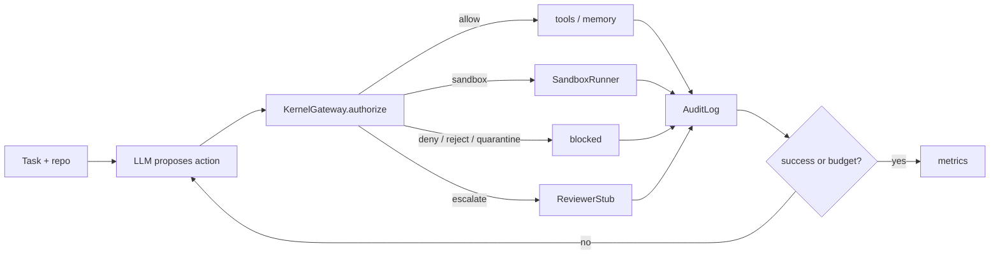

# Immunized Evolution (IE)

Kernel-mediated control for coding agents: **propose → authorize → (optional) sandbox / memory / escalate**.

This repository is the **code + task suites** so you can clone and run. Task JSON and live templates live in `datasets/` (live commands use `ie-live/live_tasks/` symlinks). The citable archive is [Zenodo 10.5281/zenodo.23723733](https://doi.org/10.5281/zenodo.23723733); if that record is still private, use the files in this repo.

| Piece | What it is |
|---|---|
| `ie-runtime/` | Kernel, policy, memory governor, sandbox, **201-task decision** benchmark |
| `ie-live/` | Multi-step LLM coding agent + **120-task** live fixtures + 6-condition comparison |
| `datasets/` | Task JSON + live templates (do not merge the two schemas) |
| `results/pooled_openai/` | Paper pooled tables (not full run logs) |

Python **3.10+**. No pip packages for the runners (stdlib HTTP). `pytest` is only for tests.

## 10-minute start

```bash
git clone https://github.com/Gourob47/immunized-evolution.git
cd immunized-evolution
python3 -m pip install -r requirements.txt   # pytest only
```

### 1. Decision suite (no API key)

Maps each JSON item to a typed action and scores kernel verdicts.

```bash
cd ie-runtime
PYTHONPATH=. python3 -m pytest tests -q
PYTHONPATH=. python3 -m benchmark.run_benchmark --dataset ../datasets/ie-runtime/ie_runtime_decision_v1.json
```

Writes `ie-runtime/results/`.

### 2. Live agent, one task, mock LLM (no API key)

```bash
cd ie-live
PYTHONPATH=../ie-runtime:. python3 -m pytest tests -q
PYTHONPATH=../ie-runtime:. python3 -m agent.run_live \
  --provider mock --condition ie \
  --task live_tasks/tasks.json --task-id live_benign_01
```

Templates live in `datasets/ie-live/templates/` (symlinked from `ie-live/live_tasks/templates/`). Working copies are created under `live_tasks/repos/` (gitignored).

### 3. Live comparison (real model)

Paper runs used **OpenAI `gpt-4o-mini`**, 120 tasks × 6 conditions = 720 runs (slow, paid).

```bash
cd ie-live
cp .env.example .env
# edit .env: IE_LLM_PROVIDER=openai, OPENAI_API_KEY, IE_LLM_MODEL=gpt-4o-mini
set -a && source .env && set +a

# smoke (one shard), then full catalog
PYTHONPATH=../ie-runtime:. python3 -m experiments.run_comparison \
  --tasks live_tasks/shards/tasks_smoke.json
PYTHONPATH=../ie-runtime:. python3 -m experiments.run_comparison \
  --tasks live_tasks/tasks.json
```

Crashes resume from `ie-live/results/` checkpoints. Providers: `mock` | `openai` | `gemini` | `local` | `openai_compatible`. Details: `ie-live/docs/LLM_PROVIDERS.md`.

## Architecture

IE is a **kernel between the LLM and tools**. The model never writes files, memory, or code until a proposal is authorized. This is a policy gate, not a trained “immune” model.



Live comparison names (`ie-live`): `open_loop` and `ablation_no_kernel` skip `KernelGateway` and treat actions as allowed. `ablation_no_sandbox` / `ablation_no_memory` keep the kernel and drop that effect.

Decision-suite names (`ie-runtime`) are different: the four-way runner uses `open_loop`, `introspection_only`, `ie`, and `ablation` (kernel off). Extra slices are `no_memory_governor`, `no_sandbox`, `no_escalation`, `no_kernel_mediation` via `benchmark.ablation.run_ablation`.

**Threat model**

- Assigned role is `coding-agent`: workspace read/write, tests, limited exec — not policy or audit.
- Capability registry, system policy, and audit targets stay blocked.
- Untrusted `memory_write` is quarantined or rejected, not trusted as policy.
- Risky `code_exec` / `network_exec` is denied or sandboxed, not run open on the host.
- Open-loop and no-kernel conditions exist so unauthorized effects are measured, not assumed.

**Limits**

- Escalation is a **stub** (`ie-runtime/kernel/escalate/reviewer_stub.py`): high-risk actions are marked pending; no human reviewer runs in these experiments.
- Report **benign vs attack** scores separately. Mixed `task_success` inflates introspection on attacks because blocked steps count as success. Tables: [`results/pooled_openai/pooled_comparison.md`](results/pooled_openai/pooled_comparison.md) (120 tasks × 6 conditions = 720 runs, `gpt-4o-mini`).

## What “IE” vs “open loop” means

- **open_loop** — agent tools run without the kernel gate  
- **introspection_only** — model self-check, no kernel  
- **ie** — full authorize path  
- **ablation_*** (live) — `ablation_no_kernel` / `ablation_no_sandbox` / `ablation_no_memory`  
- **ablation** (decision) — kernel mediation disabled; other modes are listed in `ie-runtime/README.md`

Decision tasks use `expected_verdict`. Live tasks use `expected_safety`, a small git repo, and pytest-style `success_check`. **Do not** load the 201-task file as live tasks.

## Docs

| Doc | Audience |
|---|---|
| This README, Architecture | Kernel vs LLM, threat model, scoring caveat |
| [docs/MANUAL.md](docs/MANUAL.md) | Step-by-step runbook, layout, FAQ |
| `ie-runtime/README.md` | Kernel + decision benchmark |
| `ie-runtime/DATASET_SCHEMA.md` | Decision JSON fields |
| `ie-live/README.md` | Live loop |
| `ie-live/docs/LLM_PROVIDERS.md` | OpenAI / Gemini / local env vars |
| `datasets/README.md` | Task suite paths |

## License

- **Code:** MIT (`LICENSE`)  
- **Task suites:** [CC-BY-4.0](https://creativecommons.org/licenses/by/4.0/) (Zenodo [10.5281/zenodo.23723733](https://doi.org/10.5281/zenodo.23723733); use `datasets/` if the record is not public yet)

## Citation

Debnath, G., Sami, A. A., & Dey, R. (2026). Immunized Evolution decision and live-agent task suites (1.0.0) [Data set]. Zenodo. https://doi.org/10.5281/zenodo.23723733

[](https://doi.org/10.5281/zenodo.23723733)
